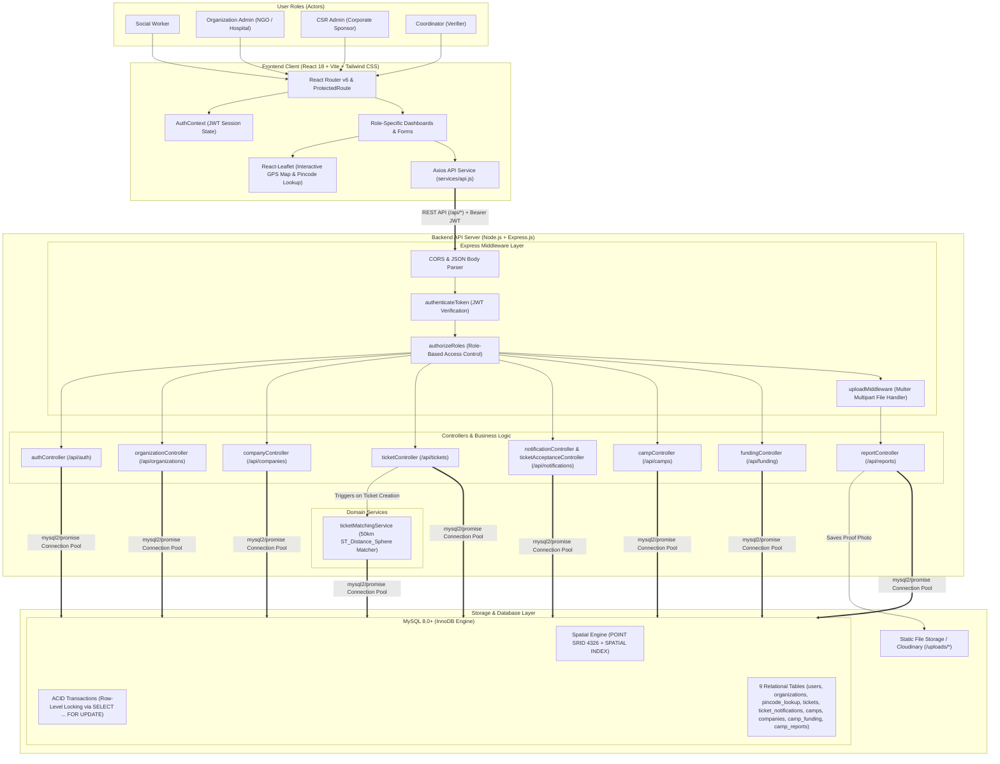
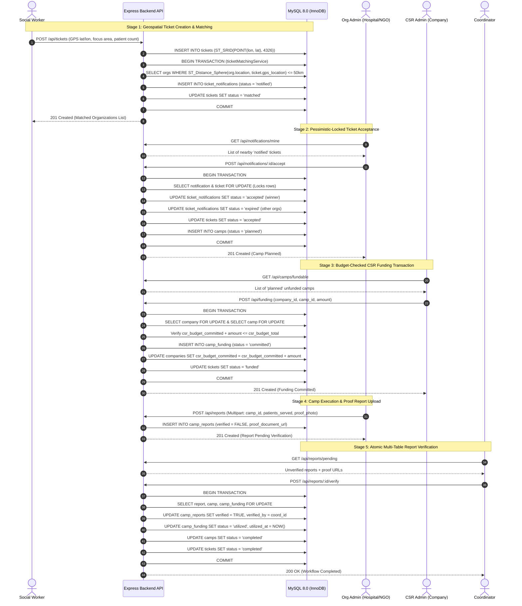
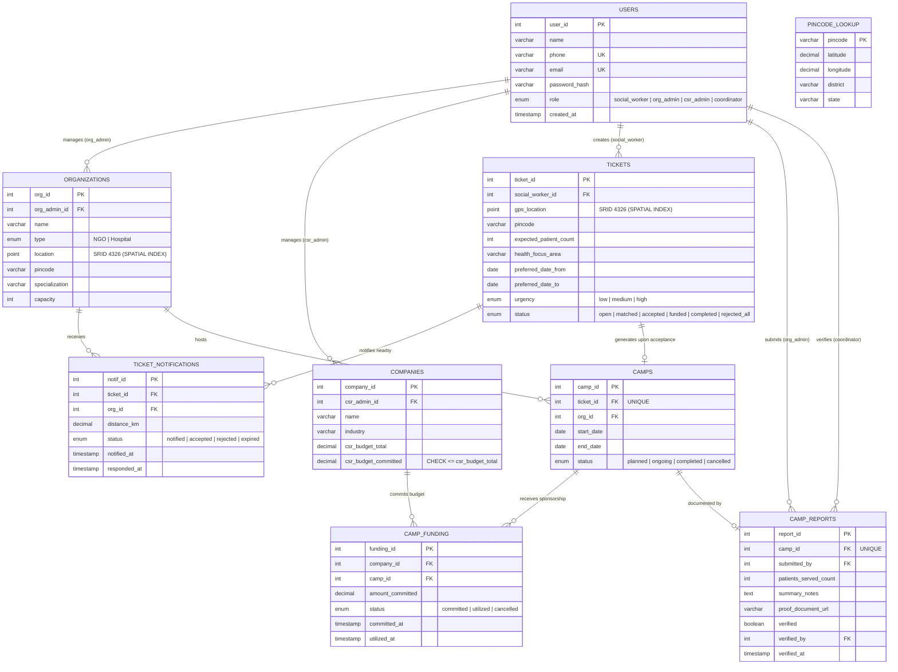
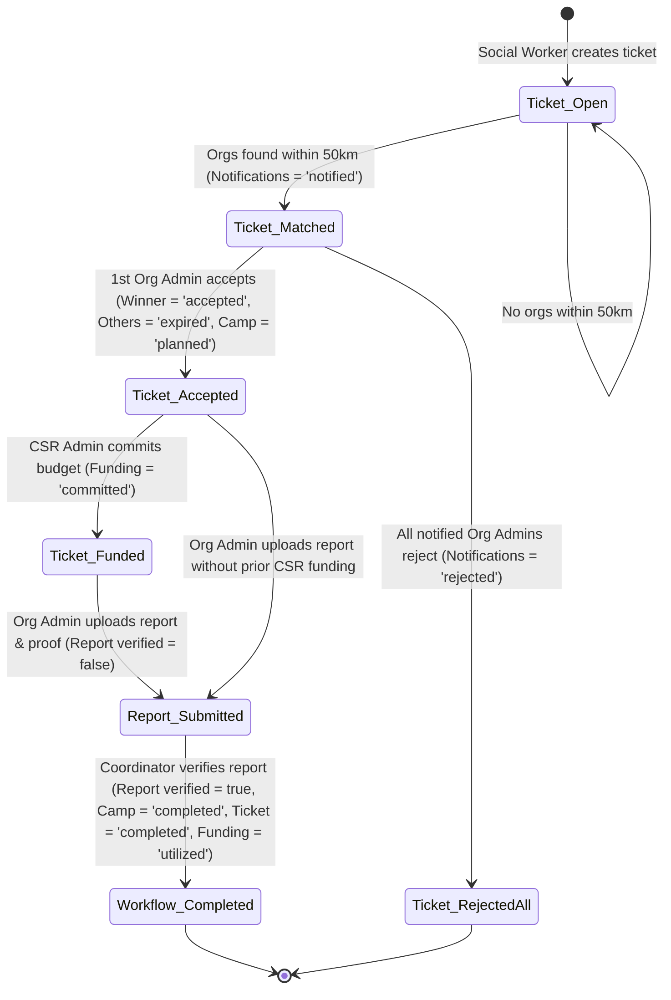

# CampConnect — System Architecture Diagrams

This document contains the complete architectural, sequence, state, and entity-relationship (ER) diagrams for **CampConnect**.

---

## 1. High-Level System Architecture Diagram

---

## 2. End-to-End Workflow & Transaction Sequence Diagram

---

## 3. Database Entity-Relationship (ER) Diagram

---

## 4. State Lifecycle Diagram (Ticket, Notification, Camp & Funding States)

