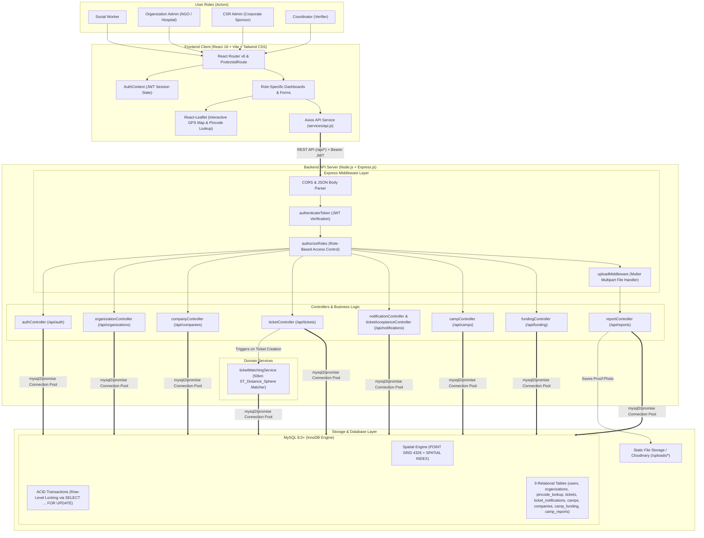

# CampConnect — Project Overview & Complete Routes Reference

## 1. Project Overview & Architecture

**CampConnect** is a full-stack platform (built as a DBMS coursework MVP) that connects four distinct user roles—**Social Workers**, **Organization Admins** (NGOs/Hospitals), **CSR Admins** (Corporate Social Responsibility sponsors), and **Coordinators**—to request, match, fund, execute, and verify rural/community health camps.

### Tech Stack
- **Frontend (`client/`)**: React 18, Vite, Tailwind CSS, React Router v6, Axios, Leaflet (`react-leaflet`) for map/location interactions.
- **Backend (`server/`)**: Node.js, Express.js, `mysql2/promise` (raw parameterized SQL queries), JWT authentication, `bcrypt` password hashing, `multer` (local/Cloudinary file uploads for camp proof documents).
- **Database (`database/`)**: MySQL 8.0+ (`InnoDB` engine) featuring **Spatial Data Types** (`POINT` with `SRID 4326`), **Spatial Indexing** (`SPATIAL INDEX`), and **ACID Transactions** with pessimistic row-level locking (`SELECT ... FOR UPDATE`).

### High-Level System Architecture Diagram

---

## 2. Database Schema Summary (`database/schema.sql`)

The application uses **9 MySQL InnoDB tables**:

1. **`users`**: Stores all system users (`user_id`, `name`, `phone`, `email`, `password_hash`, `role` $\in$ `['social_worker', 'org_admin', 'csr_admin', 'coordinator']`).
2. **`organizations`**: Stores NGO/Hospital profiles linked to an `org_admin` (`org_id`, `org_admin_id`, `name`, `type`, `location` (`POINT SRID 4326` with `SPATIAL INDEX`), `pincode`, `specialization`, `capacity`).
3. **`pincode_lookup`**: Seeded lookup table mapping pincodes to `latitude`, `longitude`, `district`, and `state`.
4. **`tickets`**: Health camp requests created by social workers (`ticket_id`, `social_worker_id`, `gps_location` (`POINT SRID 4326` with `SPATIAL INDEX`), `pincode`, `expected_patient_count`, `health_focus_area`, `preferred_date_from`, `preferred_date_to`, `urgency`, `village_head_consent`, `venue_available`, `venue_type`, `local_contact_name`, `local_contact_phone`, `electricity_available`, `water_available`, `local_volunteer_count`, `additional_details`, `status` $\in$ `['open', 'matched', 'accepted', 'funded', 'completed', 'rejected_all']`).
5. **`ticket_notifications`**: Join table linking tickets to spatially matched organizations (`notif_id`, `ticket_id`, `org_id`, `distance_km`, `status` $\in$ `['notified', 'accepted', 'rejected', 'expired']`, `notified_at`, `responded_at`).
6. **`camps`**: Created when an organization accepts a ticket (`camp_id`, `ticket_id` (UNIQUE), `org_id`, `start_date`, `end_date`, `status` $\in$ `['planned', 'ongoing', 'completed', 'cancelled']`).
7. **`companies`**: CSR entity profiles linked to a `csr_admin` (`company_id`, `csr_admin_id`, `name`, `industry`, `csr_budget_total`, `csr_budget_committed` with `CHECK (csr_budget_committed <= csr_budget_total)`).
8. **`camp_funding`**: Tracks CSR funding committed to camps (`funding_id`, `company_id`, `camp_id`, `amount_committed`, `status` $\in$ `['committed', 'utilized', 'cancelled']`, `committed_at`, `utilized_at`).
9. **`camp_reports`**: Completion reports submitted by org admins and verified by coordinators (`report_id`, `camp_id` (UNIQUE), `submitted_by`, `patients_served_count`, `summary_notes`, `proof_document_url`, `verified`, `verified_by`, `verified_at`, `submitted_at`).

---

## 3. Core End-to-End Workflow & Transactional Mechanics

1. **User & Entity Onboarding**:
   - Users register with one of four roles (`social_worker`, `org_admin`, `csr_admin`, `coordinator`).
   - An `org_admin` registers one **Organization** (`NGO` or `Hospital`), storing its GPS coordinates via `ST_SRID(POINT(lon, lat), 4326)`.
   - A `csr_admin` registers one **Company** with a total CSR budget (`csr_budget_total`).

2. **Geospatial Ticket Creation & Matching** (`ticketController.js` & `ticketMatchingService.js`):
   - A `social_worker` submits a health camp request (`tickets`) with GPS coordinates and camp requirements.
   - Immediately upon creation, `findAndNotifyNearbyOrganizations` runs a MySQL spatial query using `ST_Distance_Sphere(o.location, t.gps_location) / 1000 <= 50` to find all organizations within a **50 km radius**.
   - It inserts records into `ticket_notifications` (`status = 'notified'`) ordered by ascending distance and updates `tickets.status` from `'open'` $\rightarrow$ `'matched'`.

3. **Concurrent Ticket Acceptance / Rejection** (`ticketAcceptanceController.js`):
   - Notified `org_admin` users review incoming requests.
   - **Acceptance (`FOR UPDATE` Transaction)**: Locks both the `ticket_notifications` row and the `tickets` row (`SELECT ... FOR UPDATE`) to prevent race conditions where two organizations accept the same ticket simultaneously. The winning notification becomes `'accepted'`, all other pending notifications for that ticket are marked `'expired'`, the ticket status becomes `'accepted'`, and a new row is created in `camps` (`status = 'planned'`).
   - **Rejection**: Marks the notification `'rejected'`. If no remaining `'notified'` organizations exist for that ticket, the ticket is automatically updated to `'rejected_all'`.

4. **Transactional CSR Funding** (`fundingController.js`):
   - `csr_admin` users browse planned, unfunded camps (`camps.status = 'planned'` and `tickets.status = 'accepted'`).
   - When committing funds, `commitFunding` starts a transaction, locks the company row (`FOR UPDATE`) and camp row (`FOR UPDATE`), verifies `csr_budget_committed + amount <= csr_budget_total`, inserts a `'committed'` record into `camp_funding`, increments `companies.csr_budget_committed`, and updates `tickets.status` $\rightarrow$ `'funded'`.

5. **Camp Execution & Report Submission** (`reportController.js`):
   - After running the camp, the `org_admin` uploads a proof photo (`multipart/form-data` via `multer`) along with `patients_served_count` and `summary_notes` into `camp_reports` (`verified = FALSE`).

6. **Coordinator Report Verification** (`reportController.js`):
   - A `coordinator` reviews unverified reports and calls `verifyReport`.
   - Inside an atomic transaction (with `FOR UPDATE` locks on `camp_reports`, `camps`, and `camp_funding`), it sets:
     - `camp_reports.verified = TRUE`
     - `camp_funding.status = 'utilized'` (with `utilized_at = CURRENT_TIMESTAMP`)
     - `camps.status = 'completed'`
     - `tickets.status = 'completed'`
   - *(Supports `?simulate_error=true` query parameter to demonstrate ACID transaction rollback).*

---

## 4. All Backend API Routes (`server/src/app.js`)

All API routes are prefixed with `/api`. Protected routes require an `Authorization: Bearer <JWT_TOKEN>` header verified by `authenticateToken` (`authMiddleware.js`) and role-checked by `authorizeRoles(...)` (`roleMiddleware.js`).

### System & Static Routes
| Method | Full Path | Auth / Role | Purpose |
| :--- | :--- | :--- | :--- |
| `GET` | `/api/health` | Public | Health check (`{ success: true, message: 'CampConnect API is running' }`) |
| `GET` | `/uploads/*` | Public | Statically serves uploaded proof photos from `server/uploads/` |

### Authentication Routes (`server/src/routes/authRoutes.js`)
| Method | Full Path | Auth / Role | Controller | Description |
| :--- | :--- | :--- | :--- | :--- |
| `POST` | `/api/auth/register` | Public | `register` | Registers a user (`name`, `phone`, `email`, `password`, `role`). |
| `POST` | `/api/auth/login` | Public | `login` | Authenticates via `phone` & `password`; returns a 1-day JWT and user info. |

### Organization Routes (`server/src/routes/organizationRoutes.js`)
| Method | Full Path | Auth / Role | Controller | Description |
| :--- | :--- | :--- | :--- | :--- |
| `POST` | `/api/organizations` | `org_admin` | `createOrganization` | Creates an NGO/Hospital profile with spatial `POINT(lon, lat)` coordinates (1 per `org_admin`). |
| `GET` | `/api/organizations/:id` | Any Authenticated | `getOrganization` | Fetches organization details by `org_id` (extracting `ST_Y` as lat, `ST_X` as lon). |

### Company (CSR) Routes (`server/src/routes/companyRoutes.js`)
| Method | Full Path | Auth / Role | Controller | Description |
| :--- | :--- | :--- | :--- | :--- |
| `POST` | `/api/companies` | `csr_admin` | `createCompany` | Registers a CSR company profile and total budget (`csr_budget_total`, 1 per `csr_admin`). |
| `GET` | `/api/companies/:id` | Any Authenticated | `getCompany` | Fetches company profile and budget metrics by `company_id`. |

### Ticket Routes (`server/src/routes/ticketRoutes.js`)
| Method | Full Path | Auth / Role | Controller | Description |
| :--- | :--- | :--- | :--- | :--- |
| `POST` | `/api/tickets` | `social_worker` | `createTicket` | Creates a camp request ticket and runs spatial matching within 50 km to notify nearby orgs. |
| `GET` | `/api/tickets/mine` | `social_worker` | `getMyTickets` | Lists all tickets created by the logged-in social worker (`ORDER BY created_at DESC`). |
| `GET` | `/api/tickets/:id` | `social_worker` | `getTicketById` | Fetches a specific ticket by `ticket_id` (must belong to the logged-in social worker). |

### Notification & Acceptance Routes (`notificationRoutes.js` & `notificationAcceptanceRoutes.js`)
| Method | Full Path | Auth / Role | Controller | Description |
| :--- | :--- | :--- | :--- | :--- |
| `GET` | `/api/notifications/mine` | `org_admin` | `getMyNotifications` | Lists active (`status = 'notified'`) geospatial ticket notifications for the admin's organization. |
| `POST` | `/api/notifications/:id/accept` | `org_admin` | `acceptNotification` | Atomically accepts notification `:id`, expires competing notifications, marks ticket `'accepted'`, and creates a planned camp. |
| `POST` | `/api/notifications/:id/reject` | `org_admin` | `rejectNotification` | Atomically rejects notification `:id`; marks ticket `'rejected_all'` if no other orgs remain notified. |

### Camp Routes (`server/src/routes/campRoutes.js`)
| Method | Full Path | Auth / Role | Controller | Description |
| :--- | :--- | :--- | :--- | :--- |
| `GET` | `/api/camps/fundable` | `csr_admin` | `getFundableCamps` | Lists all `'planned'` camps that do not yet have `'committed'` or `'utilized'` funding. |
| `GET` | `/api/camps/mine` | `org_admin` | `getMyCamps` | Lists all camps belonging to the logged-in `org_admin`'s organization along with report status. |
| `GET` | `/api/camps/:id` | Any Authenticated | `getCampById` | Fetches full details of a specific camp, its organization, and ticket metadata. |

### Funding Routes (`server/src/routes/fundingRoutes.js`)
| Method | Full Path | Auth / Role | Controller | Description |
| :--- | :--- | :--- | :--- | :--- |
| `POST` | `/api/funding` | `csr_admin` | `commitFunding` | Commits CSR budget (`company_id`, `camp_id`, `amount`) to an unfunded planned camp inside a transaction. |
| `GET` | `/api/funding/mine` | `csr_admin` | `getMyFunding` | Lists all funding commitments made by the logged-in `csr_admin`'s company. |

### Report Routes (`server/src/routes/reportRoutes.js`)
| Method | Full Path | Auth / Role | Controller | Description |
| :--- | :--- | :--- | :--- | :--- |
| `POST` | `/api/reports` | `org_admin` | `submitReport` | Submits a completion report (`camp_id`, `patients_served_count`, `summary_notes`, and `proof_photo` file upload). |
| `GET` | `/api/reports/pending` | `coordinator` | `getPendingReports` | Lists all unverified (`verified = FALSE`) camp reports awaiting coordinator review. |
| `POST` | `/api/reports/:id/verify` | `coordinator` | `verifyReport` | Atomically verifies report `:id`, marks funding `'utilized'`, and marks both camp and ticket `'completed'`. |
| `GET` | `/api/reports/verified` | `coordinator` | `getVerifiedReports` | Lists all reports verified by the logged-in coordinator. |

---

## 5. All Frontend Client Routes (`client/src/App.jsx`)

Client routes are protected by role-based `ProtectedRoute` wrappers and rendered inside `MainLayout`:

| Path | Allowed Role(s) | Component | Purpose |
| :--- | :--- | :--- | :--- |
| `/` | Public | `Login` | Phone + password login screen; redirects user to their role dashboard. |
| `/register` | Public | `Register` | User registration screen (supports role selection and org/company setup). |
| `/social-worker` | `social_worker` | `SWDashboard` | Social Worker overview and quick stats. |
| `/social-worker/tickets/create` | `social_worker` | `CreateTicket` | Form + interactive map/pincode lookup to request a new health camp. |
| `/social-worker/tickets` | `social_worker` | `MyTickets` | List of submitted tickets and live status tracking (`open` $\rightarrow$ `completed`). |
| `/org-admin` | `org_admin` | `OADashboard` | Organization Admin dashboard and profile registration/summary. |
| `/org-admin/notifications` | `org_admin` | `Notifications` | View nearby matched tickets with distance (km) and Accept/Reject actions. |
| `/org-admin/reports/submit` | `org_admin` | `SubmitReport` | Upload proof photo and patient count for accepted camps. |
| `/org-admin/history` | `org_admin` | `OrgHistory` | History of all camps accepted and reports submitted by the organization. |
| `/csr-admin` | `csr_admin` | `CSRDashboard` | CSR Admin dashboard showing company profile, total budget, and committed budget. |
| `/csr-admin/camps/fundable` | `csr_admin` | `FundableCamps` | Browse planned camps awaiting sponsorship and commit CSR funds. |
| `/csr-admin/funding/history` | `csr_admin` | `FundingHistory` | Ledger of all committed and utilized CSR funding transactions. |
| `/coordinator` | `coordinator` | `CoordDashboard` | Coordinator overview of pending and verified camp reports. |
| `/coordinator/reports/pending` | `coordinator` | `PendingReports` | Review submitted camp reports, inspect proof photos, and verify completion. |
| `/coordinator/history` | `coordinator` | `CoordHistory` | Archive of reports verified by the coordinator. |
| `*` | Any | `Navigate to="/"` | Catch-all fallback redirecting unknown URLs to Login (`/`). |
