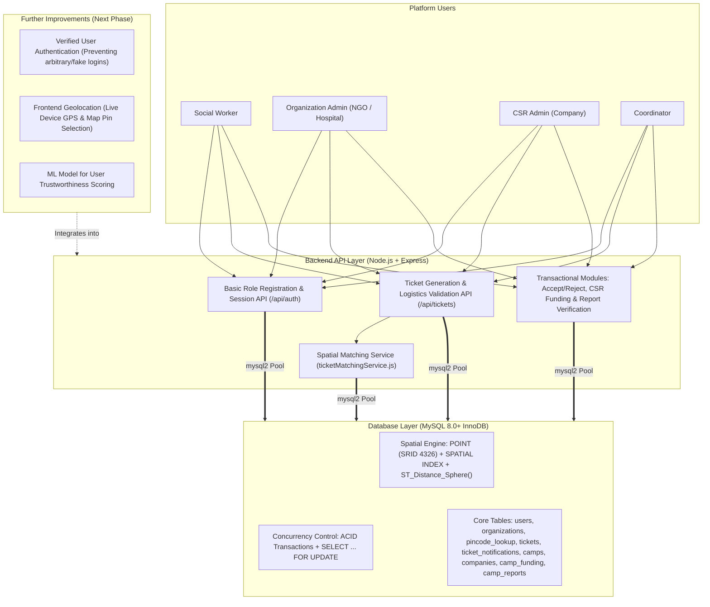

# CampConnect — Project Report Document

---

## 1. PROJECT OVERVIEW
CampConnect is a coordination platform connecting three parties involved in organizing rural medical camps: social workers who identify a village/area in need, NGOs/hospitals who can conduct a camp, and companies who fund it through their CSR budget. A social worker raises a ticket with location and ground-level logistics details; the system finds and notifies nearby registered organizations, who can accept or reject; once accepted, a company can commit CSR funds to the camp; after the camp is conducted, the organization submits a report, and once a coordinator verifies it, the funding is marked as utilized. The system does not manage medical operations (no doctor, patient, prescription, or stock tracking) and does not handle real fund transfers — it is a coordination and record-keeping layer built to demonstrate relational database design on a real-world scheduling and resource-matching problem.

---

## 2. PROBLEM BEING ADDRESSED
- Social workers who identify a genuine need for a medical camp in an area have no structured way to reach a nearby capable organization quickly — coordination currently happens informally.
- Companies with CSR healthcare budgets often fund a small number of familiar NGO partners with limited visibility into ground-level need or verified outcomes.
- There is no simple, structured record connecting a specific funded camp to a specific verified outcome.

---

## 3. DATABASE TABLES
- **`users`** `(user_id PK, name, phone, email, password_hash, role ENUM[social_worker/org_admin/csr_admin/coordinator])`
- **`organizations`** `(org_id PK, name, type ENUM[NGO/Hospital], location POINT, pincode, specialization, capacity, verified BOOLEAN)` — `SPATIAL INDEX(location)`
- **`pincode_lookup`** `(pincode PK, latitude, longitude, district, state)`
- **`tickets`** `(ticket_id PK, social_worker_id FK, gps_location POINT, pincode, expected_patient_count, health_focus_area, preferred_date_from, preferred_date_to, urgency ENUM[low/medium/high], village_head_consent ENUM[pending/confirmed/declined], venue_available BOOLEAN, venue_type ENUM[community_hall/school/temple/open_ground/other], local_contact_name, local_contact_phone, electricity_available BOOLEAN, water_available BOOLEAN, local_volunteer_count, additional_details JSON, status ENUM[open/matched/accepted/funded/completed/rejected_all], created_at)`
- **`ticket_notifications`** `(notif_id PK, ticket_id FK, org_id FK, distance_km, status ENUM[notified/accepted/rejected/expired], notified_at, responded_at)`
- **`camps`** `(camp_id PK, ticket_id FK, org_id FK, start_date, end_date, status ENUM[planned/ongoing/completed/cancelled])`
- **`companies`** `(company_id PK, name, industry, csr_budget_total, csr_budget_committed)`
- **`camp_funding`** `(funding_id PK, company_id FK, camp_id FK, amount_committed, status ENUM[committed/utilized/cancelled], committed_at, utilized_at)`
- **`camp_reports`** `(report_id PK, camp_id FK, submitted_by FK, patients_served_count, summary_notes, proof_document_url, verified BOOLEAN, verified_by FK, verified_at, submitted_at)`

---

## 4. TECH STACK

| FEATURE | WHAT IS USED |
| :--- | :--- |
| **Ticket raising** | Express REST endpoint + pincode coordinate lookup (`pincode_lookup` table) |
| **Geo-matching** | MySQL `POINT` + `ST_Distance_Sphere()` + `SPATIAL INDEX` |
| **Notifications** | In-app (`ticket_notifications` table) |
| **Accept/reject** | Express endpoint + transaction with row locking (`FOR UPDATE`) |
| **Fund commitment** | Express endpoint, transaction checking `csr_budget_total - csr_budget_committed` before allowing commitment |
| **Report submission & verification** | Express endpoint + proof upload support |
| **Frontend (Planned/In Progress)** | React (Vite), Tailwind CSS, Leaflet.js |
| **Backend & Database** | Node.js, Express, `mysql2`, MySQL 8+ (InnoDB) |

---

## 5. FULL WORKFLOW
1. Social worker submits a ticket with location and logistics details (village head consent, venue, contact person, expected patients).
2. System runs a spatial radius query against registered organizations and notifies the nearby matches.
3. The first organization to accept locks the ticket; other pending notifications are marked expired.
4. A `camps` record is created with status `planned`.
5. A company viewing the accepted camp can commit funds — `camp_funding` record created with status `committed`, and `companies.csr_budget_committed` is updated atomically (checked against total budget).
6. The organization conducts the camp independently (outside the platform's scope).
7. The organization submits a post-camp report: patients served, a short summary, and an optional proof photo.
8. A coordinator reviews and verifies the report.
9. On verification, `camp_funding.status` is updated to `utilized` — a simple, direct status change, not a conditional release chain.
10. The company can view a straightforward record: which camps they funded, and which ones have a verified outcome report.

---

## 6. ARCHITECTURE

---

## 7. ABSTRACT
CampConnect is a geo-matched medical camp coordination and CSR fund tracking platform designed to connect social workers, NGOs/hospitals, companies, and coordinators through a structured digital workflow. In rural and underserved areas, social workers may identify the need for medical camps but often lack an efficient mechanism to connect with nearby organizations capable of conducting them. At the same time, companies contributing through CSR programs may have limited visibility into where healthcare support is required and whether the funded camps produced a verified outcome.

CampConnect addresses this coordination gap by allowing social workers to raise camp requests containing geographical and logistical information such as location, expected patient count, health focus area, venue availability, urgency, and local contact details. The system uses geographical matching to identify nearby registered NGOs and hospitals and notifies them about relevant requests. Once an organization accepts a request, a camp record is created. Companies can then commit CSR funds to the accepted camp, with database transactions ensuring that commitments do not exceed the available CSR budget. After the camp is conducted, the organization submits an outcome report, which is manually verified by a coordinator before the funding is marked as utilized.

The platform is intentionally designed as a coordination and record-keeping system rather than a clinical or payment system. It demonstrates important DBMS concepts including relational modeling, normalization, foreign-key constraints, spatial indexing, transactions, concurrency control, and query optimization while addressing a practical social-impact problem.

---

## 8. COMPETITIVE LANDSCAPE — WHAT ALREADY EXISTS

| PRODUCT | WHAT IT DOES | WHAT IT DOESN'T DO |
| :--- | :--- | :--- |
| **Ezovion Medical Camp Software** | Manages camp scheduling, patient registration with offline data entry for low-connectivity sites, and camp medicine tracking at the camp-detail level | No formal request/ticketing pipeline for initiating a camp from field-level demand; enterprise product, not designed as a student-buildable relational schema exercise |
| **CampDoc** | Electronic health records for camps, medication administration tracking (eMAR), SOAP-note clinic visit logging | Entirely different domain (youth camp health records, HIPAA/US-market focus), no inventory-to-central-warehouse allocation logic, no doctor specialization-matching |
| **Perfect Patient Management System (PPMS)** | Rural clinic patient records, appointments, billing, and offline-sync when connectivity is restored | Designed for a fixed clinic, not a mobile/traveling camp model; no camp-to-camp stock allocation or request pipeline |
| **General clinic management tools (DigiQure, Pabau, Azalea)** | Digital prescriptions, appointment scheduling, and in Pabau's case stock management and reporting across a practice | Built for permanent practices with continuous stock, not the allocate-to-a-remote-camp-and-reconcile-afterward model that camps actually need |

**The specific gap CampConnect fills:** No product in this space starts from a social-worker-raised ticket as the trigger for the entire resource-allocation chain. Existing tools assume the camp has already been decided and help you run it; CampConnect also handles deciding which camps to run and where, based on structured field-level demand signals — which is the actual bottleneck NGOs describe when camps are organized reactively rather than by tracked need.

---

## 8. IMPLEMENTED SO FAR
For this phase of the project, we chose to focus first on the two parts of CampConnect that are most database-intensive — ticket generation and geo-matching — rather than starting with the frontend or the simpler CRUD modules. The idea was to prove out the hardest technical pieces early, while we still have time to fix problems if something in the schema or query design doesn't hold up.

**What's working right now**
We've set up the core MySQL schema for this phase, including the `users`, `organizations`, `pincode_lookup`, `tickets`, and `ticket_notifications` tables. The two tables that matter most technically — `organizations` and `tickets` — store their location as a proper spatial `POINT` type rather than plain latitude/longitude numbers, with a spatial index on both, since that's what lets our geo-matching query run efficiently instead of scanning every row. We also seeded the database with hospitals and NGOs across multiple regions so our testing reflects a realistic geographic spread across districts rather than arbitrary coordinates.

On the backend, basic role registration and login endpoints are set up so users can be created under any of our four roles with hashed passwords and JWT tokens for API session testing, though strict user identity verification is not yet enforced. Ticket creation is also working at the API level: a social worker can submit a ticket with the entire logistics questionnaire we designed — expected patient count, health focus area, preferred dates, urgency, whether the village head has consented, venue availability and type, a local contact person, electricity and water availability, and a flexible JSON field for anything camp-specific that doesn't need its own fixed column. At this stage, location coordinates are provided directly in the API request or resolved from the `pincode_lookup` table rather than captured from live device GPS or an interactive map pin.

The geo-matching itself is implemented and working: the moment a ticket is created, we run a spatial radius query using MySQL's `ST_Distance_Sphere` function against every registered organization, and any organization within the configured radius gets a notification record created for it automatically. We tested this against our seeded dataset across different locations, and it behaves as expected — raising a ticket accurately surfaces the closest organizations in that region ordered by distance, and widening or narrowing the search radius dynamically filters organizations in or out of the results.

We've also built a Postman collection to test all of this at the API level before touching any frontend — basic registration and login for each role, ticket creation with both valid and intentionally invalid payloads to confirm validation is actually enforced, and the geo-matching endpoint at a few different radius values to confirm the distance filtering works correctly.

---

## 9. FURTHER IMPROVEMENTS / WHAT'S LEFT TO BUILD

1. **Proper User Authentication & Verification**
   Right now, anyone can register and log in using whatever phone number, email, or role data they type in without verification. As a primary improvement, we need to implement proper user authentication and verification — such as OTP verification on phone numbers and credential/admin approval (`organizations.verified`) before an account can operate as a social worker, NGO/Hospital admin, CSR company, or Coordinator — ensuring users cannot log in with arbitrary or fake details.

2. **Geolocation via Live GPS or Selecting a Pin on the Map**
   Currently, coordinates are passed manually in API payloads or resolved from a static pincode table. When building the frontend application, we need to implement interactive geolocation capture so users can either automatically fetch their live location using **device GPS (Browser Geolocation API)** or **select/drop a pin directly on an interactive map (Leaflet.js)** to mark the exact village or hospital location.

3. **ML Model for User Trustworthiness**
   Because the workflow relies on social workers raising camp requests and organizations submitting completion reports, we plan to implement a **Machine Learning (ML) model to evaluate User Trustworthiness**. The ML model will compute a trustworthiness score for users based on their platform history and request patterns — such as the ratio of verified vs. rejected tickets/reports, consistency between expected patient counts and actual served counts, completeness of ground-level logistics details, and past coordinator verification outcomes. This score will help organizations and CSR companies identify reliable social workers and filter out spam or low-trust requests.

4. **Accept/Reject Concurrency, CSR Funding, Reporting & Frontend UI**
   * **Accept/Reject Workflow & Concurrency:** Allowing notified organizations to formally accept or decline a ticket using InnoDB row-level locking (`FOR UPDATE`), ensuring that if two organizations try to accept the same ticket simultaneously, the database guarantees only one wins.
   * **Funding & Reporting Modules:** Building registration flows for organizations and companies, funding commitment logic that checks `csr_budget_total - csr_budget_committed` before committing funds, post-camp outcome report submission, and coordinator verification.
   * **Frontend Screens & Database Benchmarks:** Building the React frontend interface and running our database demonstrations comparing `ST_Distance_Sphere` query execution times with and without the spatial index, as well as firing simultaneous accept requests to prove concurrency handling under contention.

---

## 10. IMPLEMENTATION DETAILS OF THE COMPLETED FURTHER IMPROVEMENTS

### 1. Proper User Authentication & Phone OTP Verification
- **Backend Flow (`authController.js` & `authRoutes.js`):**
  - Added dedicated endpoints: `POST /api/auth/send-otp`, `POST /api/auth/verify-otp`, `POST /api/auth/resend-otp`, and `GET /api/auth/me`.
  - When users register, `requires_otp: true` is enforced and `phone_verified` is initialized to `FALSE`. In development/testing mode, `dev_otp` is provided in the JSON response to enable seamless testability without third-party SMS costs.
  - Users cannot log in if unverified (`403 Forbidden` with `code: 'PHONE_NOT_VERIFIED'`).
  - Added role credential capture for `org_admin` (NGO Darpan / Hospital Clinical Establishment Registration No.), `csr_admin` (Corporate CIN / MCA CSR-1 Reg. No.), and `coordinator` (Official Badge / Staff ID).
- **Frontend Flow (`Register.jsx` & `Login.jsx`):**
  - `Register.jsx` features a 2-step registration process: details entry followed by an interactive 6-digit OTP verification screen with resend capabilities.
  - `Login.jsx` automatically prompts users whose numbers are unverified with an inline OTP verification card, allowing instant verification and sign-in.

### 2. Interactive Geolocation (Live Device GPS & Map Pin Selection)
- **Frontend Implementation (`CreateTicket.jsx`):**
  - **Live Device GPS:** Integrated `navigator.geolocation.getCurrentPosition` with high-accuracy GPS locking. Smoothly centers and flies the Leaflet map to the user's exact coordinates (`map.flyTo(pos, 13)`).
  - **Interactive Draggable Pin:** Integrated a custom Leaflet draggable marker (`LocationPicker`). Users can click anywhere on the map or drag the pin directly to the exact school ground, temple, or community hall.
  - **Reverse Geocoding:** Automatically fetches postal code, locality, and district names via OpenStreetMap Nominatim when the pin is dropped or dragged, automatically filling the `pincode` field.
  - **Pincode Jump:** Added a "Jump to Pin" lookup that navigates the map directly to any entered 6-digit postal code.

### 3. Machine Learning Model for User Trustworthiness
- **ML Scoring Service (`trustworthinessMLService.js`):**
  - Employs a feature-weighted scoring algorithm calibrated across ground logistics and credibility indicators:
    1. *Village Head Consent* (`confirmed` +25%, `pending` +5%, `declined` -30%).
    2. *Site Infrastructure* (Dedicated venue +12%, clean water & electricity +8%).
    3. *Patient-to-Volunteer Ratio* (Realism check detecting unrealistic patient estimates without volunteers).
    4. *Contact Authenticity* (Validation against fake/repetitive phone patterns).
    5. *Clinical Focus Specificity* (Specificity of requested health focus area).
    6. *Bayesian User Track Record* (Historical completion rate of past tickets).
  - Outputs a calibrated Trust Score (0–100%), categorical Trust Level (`High Credibility`, `Moderate Trust`, `Needs Review`), and actionable risk/positive factor signals.
- **API & Workflow Integration:**
  - `POST /api/tickets`: Automatically scores every newly created ticket and embeds the analysis into `additional_details`.
  - `GET /api/notifications/mine`: Exposes `trust_score`, `trust_level`, and `trust_analysis` to registered hospitals so they can assess ground credibility before accepting.
  - `POST /api/trust/evaluate-ticket`: Provides on-the-fly evaluation as tickets are drafted.
- **Frontend Integration:**
  - `CreateTicket.jsx`: Displays a real-time **ML Trustworthiness Meter** as the social worker fills out the form.
  - `Notifications.jsx`: Displays the **ML Trust Badge** on each incoming notification card for hospital admins.
  - `MyTickets.jsx`: Displays the ML Trust Score badge on the social worker's ticket list.
